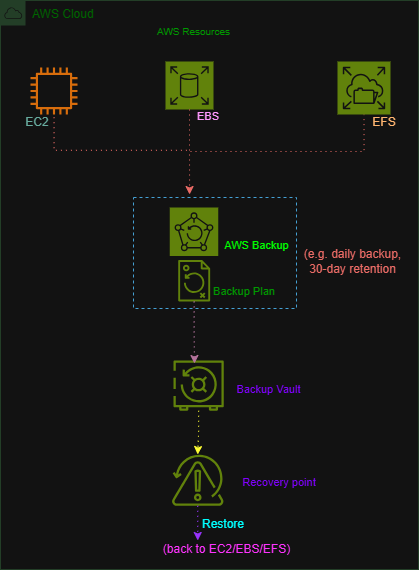

# AWS Backup – Centralized Backup Architecture

## Overview

AWS Backup is a fully managed backup service that provides centralized management and automation for backing up AWS resources.

In this project, I designed an AWS Backup architecture showing how multiple AWS resources can be protected using a centralized backup plan, backup vault, and recovery points.

## AWS Services

* AWS Backup
* Amazon EC2
* Amazon EBS
* Amazon EFS

## Architecture



The architecture shows multiple AWS resources being protected by AWS Backup.

AWS Backup uses a backup plan to define when backups should run and how long they should be retained. The resulting backups are stored as recovery points in a backup vault.

## Architecture Components

### Amazon EC2

An EC2 instance is included as an example AWS resource that can be protected through AWS Backup.

### Amazon EBS

EBS volumes attached to EC2 instances can be backed up to help protect stored data.

### Amazon EFS

Amazon EFS file systems can be protected using AWS Backup.

### AWS Backup

AWS Backup provides centralized backup management for supported AWS resources.

### Backup Plan

A backup plan defines backup rules such as:

* Backup schedule
* Backup frequency
* Retention period
* Backup lifecycle settings

Example shown in the architecture:

> Daily backup
> 30-day retention

### Backup Vault

A backup vault is a logical container used to store and organize recovery points.

### Recovery Point

A recovery point represents a backup that can be used to restore a protected resource.

## How It Works

1. AWS resources such as EC2, EBS, and EFS are selected for backup.
2. AWS Backup uses the configured backup plan.
3. The backup plan determines when backups should be created and how long they should be retained.
4. Backups are stored in a backup vault as recovery points.
5. A recovery point can be used to restore the protected resource when needed.

## Backup Flow

```text
AWS Resources
      ↓
  AWS Backup
      ↓
  Backup Plan
      ↓
  Backup Vault
      ↓
 Recovery Point
      ↓
    Restore
```

## Key Concepts Learned

* AWS Backup
* Backup plans
* Backup rules
* Backup schedules
* Retention periods
* Backup vaults
* Recovery points
* Resource protection
* Backup and restore
* Centralized backup management


## What I Learned

This architecture exercise helped me understand how AWS Backup can provide centralized backup management instead of managing backups individually for each resource.

I also learned the relationship between backup plans, backup vaults, and recovery points, and how these components work together to support backup and restoration.

## Project Status

**Completed — Architecture Exercise**

> **Note:** This project was completed as a learning and architecture exercise. No production infrastructure was deployed.

> No AWS console lab was completed for this exercise because a suitable free hands-on AWS Backup lab was not available without requiring an AWS payment card.
