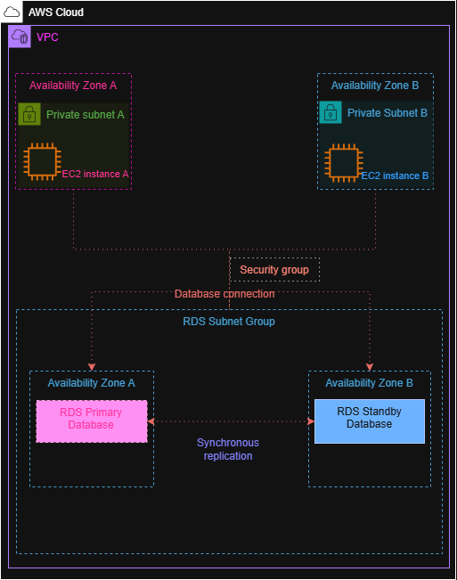

# Amazon RDS – Multi-AZ Architecture

## Overview

Amazon Relational Database Service (Amazon RDS) is a managed relational database service that makes it easier to set up, operate, and scale relational databases in AWS.

In this project, I designed a highly available Amazon RDS architecture using multiple Availability Zones. The architecture shows application servers running in private subnets and an Amazon RDS database configured with a primary database and a standby database across two Availability Zones.

## AWS Services

* Amazon RDS
* Amazon EC2
* Amazon VPC
* Amazon VPC Subnets
* Amazon Security Groups

## Architecture

The architecture uses two Availability Zones within a VPC.

Each Availability Zone contains a private subnet with an EC2 instance. The application instances connect to the Amazon RDS database through a database connection protected by security groups.

The RDS database uses a Multi-AZ configuration, with the primary database in one Availability Zone and a standby database in another Availability Zone.

## Architecture Components

### Amazon VPC

Provides the isolated network environment for the application and database resources.

### Availability Zones

Two Availability Zones are used to improve availability and provide redundancy.

### Private Subnets

The EC2 instances and RDS databases are placed in private subnets so the database layer is not directly exposed to the public internet.

### Amazon EC2

The EC2 instances represent application servers that communicate with the RDS database.

### RDS Subnet Group

An RDS subnet group identifies the subnets that Amazon RDS can use for database deployment. The architecture includes subnets across two Availability Zones.

### Amazon RDS Primary Database

The primary RDS database handles the database operations from the application.

### Amazon RDS Standby Database

The standby database is located in a separate Availability Zone and provides redundancy for high availability.

### Security Group

Controls network traffic allowed between the application instances and the RDS database.

## How It Works

1. Application traffic reaches the EC2 instances running in the private subnets.
2. The EC2 instances connect to the RDS database.
3. The RDS primary database handles the database operations.
4. Data is synchronously replicated to the standby database in another Availability Zone.
5. If the primary database becomes unavailable, RDS can fail over to the standby database.

## Multi-AZ

Multi-AZ is designed primarily for **high availability and failover**.

The standby database is not intended to be used as a normal read-only database by the application.

This is different from an **RDS Read Replica**, which is primarily used to scale read workloads.

## Key Concepts Learned

* Amazon RDS
* Relational databases
* RDS DB instances
* RDS subnet groups
* Private subnets
* Security groups
* Availability Zones
* Multi-AZ deployments
* Synchronous replication
* Database failover
* High availability

## What I Learned

This architecture exercise helped me understand how Amazon RDS can be placed inside a VPC and designed for high availability using multiple Availability Zones.

I also learned the difference between an RDS Multi-AZ deployment and a Read Replica, as well as the role of private subnets, security groups, and RDS subnet groups.

## Project Status

**Completed — Architecture Exercise**

> **Note:** This project was completed as a learning and architecture exercise. No production infrastructure was deployed.

> No AWS console lab was completed for this exercise because a suitable free hands-on RDS lab was not available without requiring an AWS payment card.
