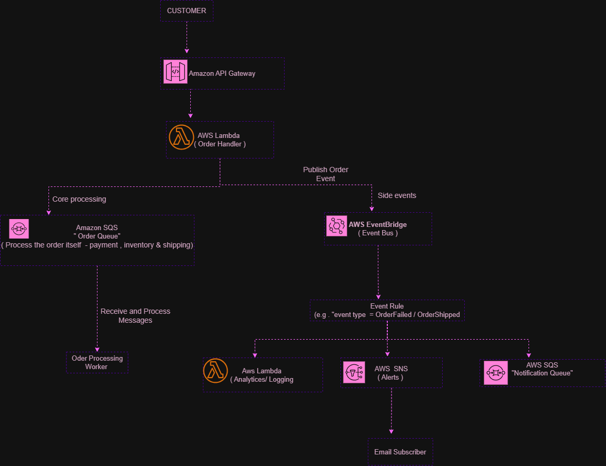

# Serverless and Messaging – AWS Projects

## Overview

This project brings together five AWS services I've been learning: AWS Lambda, Amazon API Gateway, Amazon SQS, Amazon SNS, and Amazon EventBridge.

The combined architecture uses an example online ordering system to show how these services can work together to handle customer requests, process orders, and send notifications.

## Combined Architecture

## How It Works

1. **API Gateway** receives a customer's request and sends it to a Lambda function.
2. **Lambda** handles the request, sends an order message to SQS, and publishes an event to EventBridge.
3. **SQS** holds the order message until an order-processing worker retrieves and processes it.
4. **EventBridge** checks incoming events against a rule and routes matching events to configured targets.
5. **SNS** sends notifications to subscribers, such as an email recipient. EventBridge can also send matching events to another SQS queue or Lambda function.

## What I Learned

I learned how these services serve different purposes and can work together. API Gateway handles incoming requests, Lambda runs code, SQS queues messages, SNS distributes notifications, and EventBridge routes events.

## Project Status

Completed as a learning and architecture design project. I completed hands-on Skill Builder labs for Lambda and API Gateway and created architecture diagrams for SQS, SNS, and EventBridge.

The combined architecture is a conceptual design; the complete system has not been deployed.
