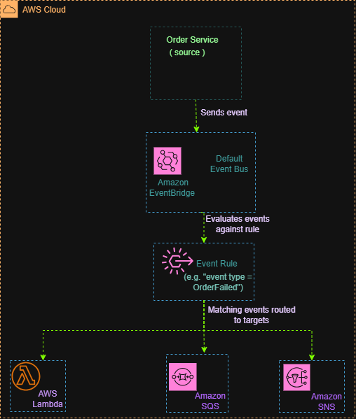

# Amazon EventBridge – Event-Driven Architecture

## Overview

This project demonstrates how Amazon EventBridge can route events from an application to different AWS services based on rules.

The example uses an order service that sends events to the EventBridge default event bus. An event rule evaluates incoming events and routes matching events to configured targets, such as AWS Lambda, Amazon SQS, and Amazon SNS.

This project is an architecture design exercise intended to demonstrate an understanding of event-driven architectures.

## AWS Services Used

* **Amazon EventBridge:** Receives events and routes matching events to configured targets.
* **AWS Lambda:** Runs code to process matching events.
* **Amazon SQS:** Stores messages in a queue for asynchronous processing.
* **Amazon SNS:** Distributes notifications to subscribed endpoints.
* **Order Service:** The example application that produces order-related events.

## Architecture Diagram

## How It Works

1. The order service generates an event, such as an order failure.
2. The event is sent to the Amazon EventBridge default event bus.
3. An event rule evaluates the event against its configured event pattern.
4. If the event matches the rule, EventBridge routes it to the configured targets.
5. AWS Lambda can process the event by running code.
6. Amazon SQS can receive a message for later processing.
7. Amazon SNS can distribute a notification to its subscribers.

The actual behavior depends on the event rule, target configuration, and required permissions.

## Key Concepts Learned

* Event-driven architecture
* Event sources and event buses
* Event patterns and rules
* Event routing
* Targets and integrations
* Integration with AWS Lambda, Amazon SQS, and Amazon SNS

## What I Learned

I learned how Amazon EventBridge connects event producers with services that respond to events. Rules allow events to be routed to appropriate targets, helping applications respond to events without requiring every component to communicate directly with every other component.

## Project Status

**Completed** — Architecture design exercise.

The diagram was created to demonstrate understanding of Amazon EventBridge and event routing. No AWS infrastructure was deployed for this project.
