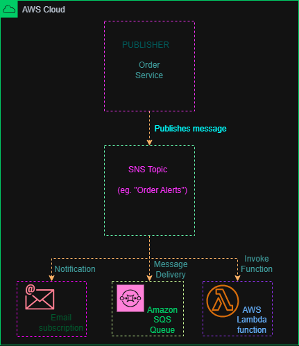

# Amazon SNS – Order Notification Architecture

## Overview

This project demonstrates how Amazon Simple Notification Service (Amazon SNS) can distribute messages from a publisher to multiple subscribers.

The example uses an order service that publishes a message to an SNS topic called **Order Alerts**. The topic distributes the message to subscribers, including an email endpoint, an Amazon SQS queue, and an AWS Lambda function.

This project is an architecture design exercise intended to demonstrate how Amazon SNS works.

## AWS Services Used

* **Amazon SNS:** Distributes published messages to subscribed endpoints.
* **Amazon SQS:** Receives and stores messages in a queue for later processing.
* **AWS Lambda:** Executes code in response to messages delivered by SNS.
* **Order Service:** The example application that publishes messages to the SNS topic.
* **Email Subscription:** An endpoint that can receive SNS notifications by email.

## Architecture Diagram

## How It Works

1. The order service generates a notification message.
2. The publisher sends the message to the Amazon SNS topic.
3. SNS evaluates the topic's subscriptions.
4. SNS delivers the notification to the configured email endpoint.
5. SNS sends a copy of the message to the subscribed SQS queue.
6. SNS invokes the subscribed Lambda function with the message.

Actual delivery depends on correctly configured subscriptions, permissions, and endpoint requirements.

## Key Concepts Learned

* Publish/subscribe messaging
* SNS topics and subscriptions
* Publishers and subscribers
* Message fan-out
* SNS integration with SQS
* SNS integration with Lambda
* Event-driven architectures

## What I Learned

I learned how Amazon SNS allows one publisher to send a message to multiple subscribers through a topic. I also learned how SNS can integrate with services such as SQS and Lambda to support notification and event-driven workflows.

## Project Status

**Completed** — Architecture design exercise.

The diagram was created to demonstrate understanding of Amazon SNS and message fan-out. No AWS infrastructure was deployed for this project.
