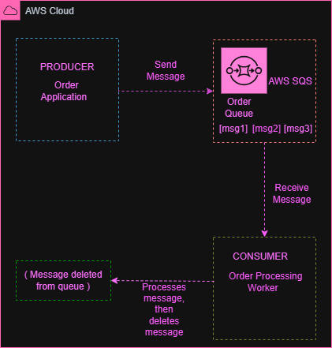

# Amazon SQS – Order Processing Architecture

## Overview

This project demonstrates how Amazon Simple Queue Service (Amazon SQS) can be used to decouple an application that sends messages from a worker that processes them.

The architecture uses an order application as the message producer, an SQS queue to hold messages, and an order processing worker as the consumer.

This is an architecture design exercise created to understand how Amazon SQS works.

## AWS Services and Components

* **Amazon SQS:** Stores messages until they are processed by a consumer.
* **Producer – Order Application:** Sends order messages to the SQS queue.
* **Consumer – Order Processing Worker:** Receives messages from the queue and processes them.

## Architecture Diagram

## How It Works

1. The order application creates an order message.
2. The producer sends the message to the Amazon SQS queue.
3. Amazon SQS stores the message until a consumer retrieves it.
4. The order processing worker receives and processes the message.
5. After successful processing, the worker calls the `DeleteMessage` operation to remove the message from the queue.

If processing fails, the message can become available for another attempt after the visibility timeout expires.

## Key Concepts Learned

* Message queues
* Producers and consumers
* Decoupling applications
* Sending and receiving messages
* Message visibility timeout
* Deleting processed messages
* Asynchronous communication

## What I Learned

I learned how Amazon SQS allows applications to communicate without requiring the producer and consumer to process messages at the same time. The queue stores messages until they can be processed, helping separate message creation from message processing.

## Project Status

**Completed** — Architecture design exercise.

The architecture was created to demonstrate understanding of Amazon SQS and message processing. No AWS infrastructure was deployed for this project.
